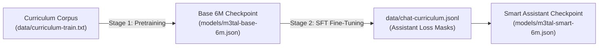

# 04 Pretraining and SFT Pipeline

## Goal
Implement a robust two-stage training pipeline: foundational causal pretraining on curriculum prose followed by Chain-of-Thought Supervised Fine-Tuning (SFT) using assistant-only loss masks.

## The Two-Stage Strategy



### Stage 1: Causal Pretraining (The Foundation)
- **Objective**: Next-token cross-entropy loss over the combined curriculum corpus.
- **Goal**: Teach the model English grammar, spelling, facts, markdown syntax, and general narrative consistency.
- **Optimizer Config**:
  - AdamW ($\beta_1=0.9, \beta_2=0.98, \epsilon=10^{-8}$)
  - Global gradient-norm clipping: $1.0$
  - Learning rate: $0.003$ peak
  - Warmup: 200 steps
  - Cosine decay with floor ratio: $0.15$
  - Total steps: ~4,000 steps (~1M tokens seen)

### Stage 2: Supervised Fine-Tuning with Assistant Loss Masks
- **Template**: `m3tal.chatml.v1` (`internal/lm/chat.go`):
  ```text
  <|im_start|>system\n{system_message}<|im_end|>\n
  <|im_start|>user\n{query}<|im_end|>\n
  <|im_start|>assistant\nThought: {reasoning}\n{answer}<|im_end|>\n
  ```
- **Assistant-Only Masking (`internal/lm/sft.go`)**:
  - Loss gradients are zeroed for all user turns, system prompts, and delimiters.
  - Loss gradients are calculated **only** on the tokens generated by the assistant and its terminating `<|im_end|>`.
  - Prevents the model from memorizing user queries; focuses 100% of capacity on answering accurately.

## Steps
1. Execute Stage 1 pretraining using `m3tal-lm train --corpus ...`.
2. Verify pretraining convergence: held-out loss on `data/curriculum-val.txt` drops below **2.50**.
3. Execute Stage 2 SFT using `m3tal-lm train --base-model models/m3tal-base-6m.json --sft data/chat-curriculum.jsonl ...`.
4. Verify SFT convergence: masked assistant loss drops below **1.00**.

## Definition of Done
- Pretrained checkpoint `models/m3tal-base-6m.json` saved and verified.
- SFT checkpoint `models/m3tal-smart-6m.json` saved and verified.
- Deterministic resume verified via `TestCheckpointResumeIsDeterministic`.
