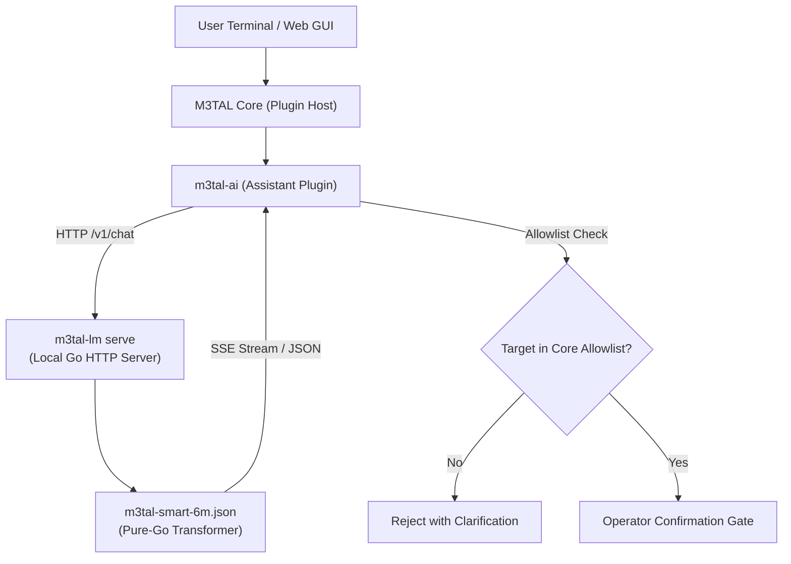

# 06 Ecosystem Integration and Serving

## Goal
Wire the trained 6.05M model into the live M3TAL ecosystem (`m3tal-ai` and `M3tal-core`) using the native HTTP API server, Go client adapter, and safety allowlist boundaries.

## Architecture



## Serving Endpoint Specification (`m3tal-lm serve`)

- **Port**: Default `:8080` (configurable via `--port`)
- **Transport**: Pure Go `net/http` server with zero external dependencies.
- **Endpoints**:
  - `GET /healthz`: Liveness, parameter count, backend (`cpu`/`cuda`).
  - `POST /v1/chat`:
    - Accepts standard chat payloads: `{"messages": [...], "stream": true, "temperature": 0.2, "top_p": 0.9}`.
    - `stream: true` streams server-sent events (`data: {"delta": "..."}`).
    - `<|im_end|>` terminates generation and is stripped from client streams.

## Go Client Integration (`m3tal-plugins/m3tal-ai`)

Wire the client adapter into `m3tal-plugins/m3tal-ai`:

```go
package main

import (
    "m3tal-llm/internal/llmclient"
    "m3tal-plugin-ai/internal/assistant"
)

func attachLocalBrain(agent *assistant.Assistant, endpoint string) {
    client := llmclient.New(endpoint)
    agent.SetLanguageModel(llmclient.NewGenerator(client))
}
```

## Security & Safety Boundaries
1. **Model output is never executable directly**:
   The model can only propose JSON tool steps (`ToolStep{Tool, Target}`).
2. **Core Allowlists**:
   Before any step is presented to the user, Core confirms that the requested container/service exists in its active live inventory.
3. **Operator Confirmation**:
   Any state mutation (`restart`, `stop`, `start`) halts and requires exact user confirmation:
   `confirm <action> <target-type> <name>`.
4. **Resilient Fallback**:
   If `m3tal-lm serve` is offline or crashes, `m3tal-ai` falls back to deterministic rule-based routing without failing or interrupting system operations.

## Definition of Done
- `m3tal-lm serve --checkpoint models/m3tal-smart-6m.json` starts and passes `GET /healthz`.
- `curl -N http://localhost:8080/v1/chat` verifies live streaming SSE.
- `m3tal-ai --interactive` executes queries powered by the local model.
- Disconnecting the model server triggers safe fallback with zero crashes.
