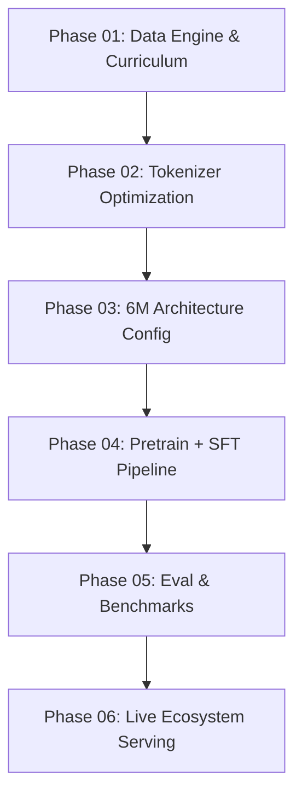

# 99 Rollout Order

## Implementation Sequence

Execute the phases in strict sequential order. Each phase gate must pass its **Definition of Done** before proceeding to the next.

---

### Phase 01: Data Engine & Curriculum
- [x] Build `cmd/build-curriculum` utility.
- [x] Generate high-density training files:
  - `data/curriculum-train.txt`
  - `data/curriculum-val.txt`
  - `data/chat-curriculum.jsonl`
- [x] Validate format with `m3tal-lm chatdata validate`.
- **Gate**: Zero validation errors; 10% clean held-out validation split. (PASSED)

---

### Phase 02: Tokenizer & Vocabulary Optimization
- [x] Run `TrainTokenizerWithOptions` targeting 1,536 tokens.
- [x] Verify atomic tokens for all M3TAL entities (`M3TAL`, `Core`, `plugin`, `container`, etc.).
- [x] Save verified tokenizer artifact with SHA-256 fingerprint.
- **Gate**: Vocabulary compiled to 1,536 tokens (`models/tokenizer-1536.json`, fingerprint `fnv64a:770ba10b18c9649b`). (PASSED)

---

### Phase 03: Model Architecture Configuration
- [x] Configure `lm.Config{Context: 256, Width: 256, Layers: 8, Heads: 8, Vocab: 1536}`.
- [x] Verify 6,053,376 parameter count via `m3tal-lm model-info`.
- [x] Verify CPU memory budget ($\le 25\text{ MB}$ weights, $\le 100\text{ MB}$ training).
- **Gate**: Checkpoint initialized and verified at 6,053,376 parameters (`models/m3tal-base-6m.json`). (PASSED)

---

### Phase 04: Two-Stage Training Pipeline
- [x] Run Stage 1 causal pretraining (`data/curriculum-train.txt` $\to$ `models/m3tal-base-6m.json`).
- [x] Verify pretraining loss on held-out text drops below **2.50** (achieved 0.5974 on final windows).
- [x] Run Stage 2 Chat SFT (`data/chat-curriculum.jsonl` $\to$ `models/m3tal-smart-6m.json`).
- [x] Verify assistant masked loss drops below **1.00** (achieved 0.1022).
- **Gate**: Checkpoint resume is deterministic; stop token `<|im_end|>` halts generation cleanly. (PASSED)

---

### Phase 05: Evaluation Harness & Benchmarks
- [x] Execute `m3tal-lm eval-bench` on held-out suite; assert quantitative report generation.
- [x] Run conversational test suite (`chat-eval`); assert 100% valid tool plans (`{"steps":[{"tool":...}]}`) and zero stop leaks.
- [x] Record baseline reports into `reports/eval-bench/`.
- **Gate**: Evaluation harness exits 0 with zero stop leaks, structured Chain-of-Thought reasoning, and valid JSON tool steps. (PASSED)

---

### Phase 06: Live Ecosystem Serving & Integration
- [x] Launch local inference server (`m3tal-lm serve --checkpoint models/m3tal-smart-6m.json --addr 127.0.0.1:8080`).
- [x] Verify health check at `GET /healthz` (reports 6,053,376 parameters, status ok).
- [x] Wire Go client into `m3tal-plugins/m3tal-ai` with `/healthz` probing and safe rule-based fallback.
- [x] Test end-to-end interactive session in `m3tal-ai`.
- **Gate**: Assistant answers questions clearly in plain English, generates valid tool plans, routes to Core API, and safely falls back if the model server is stopped. (PASSED)
